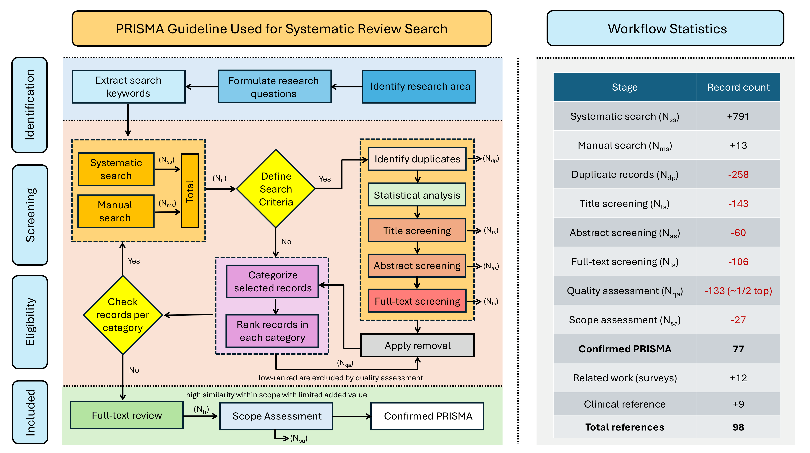
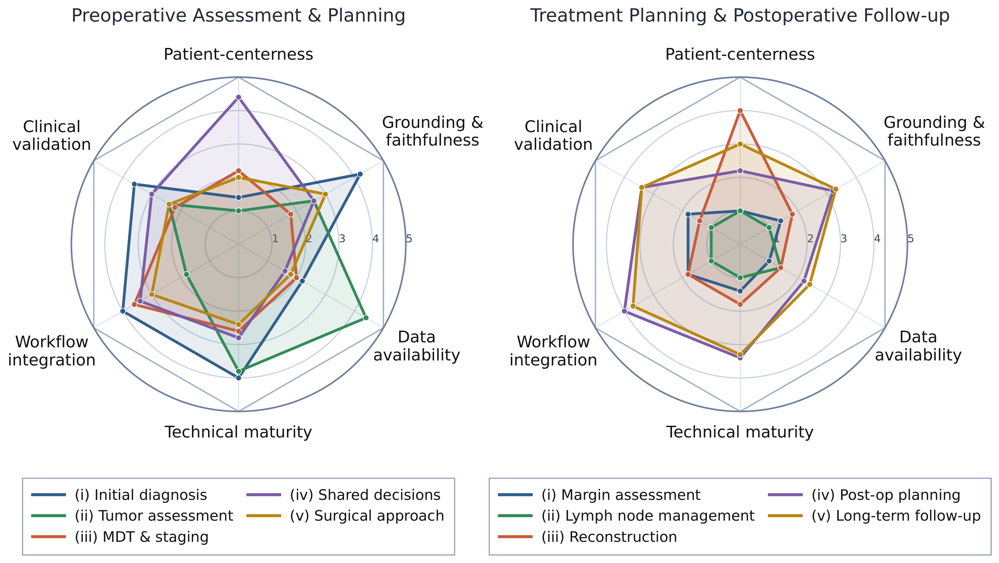
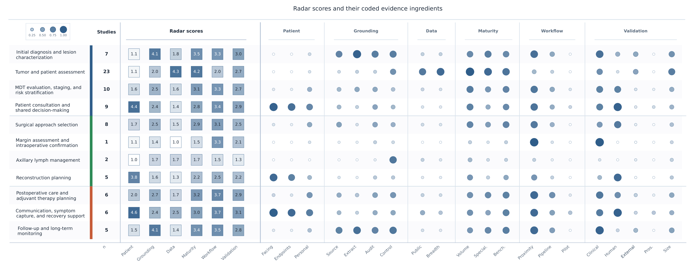

# Exploring the Role of Generative-AI on Breast Cancer Surgical Planning: A Systematic Review

**Authors**: Mohammad Hossein Zolfagharnasab, Felipe Coutinho, Helena Montenegro, Bruno Coelho, Leonardo Ferreira, Eduard-Alexandru Bonci, Helena Vaz Cruz, Helder P. Oliveira, Maria J. Cardoso, Jaime S. Cardoso  
**Corresponding author**: mohammad.h.zolfagharnasab@inesctec.pt

---

## Repository overview

This repository accompanies the systematic review **“Exploring the Role of Generative-AI in Surgical Planning for Breast Surgery: A Systematic Review on Use-cases, Challenges, and Future Directions.”**  
It contains the full screening trail used to build the review corpus, the intermediate categorization files, the stage-wise inclusion/exclusion logs, the algorithmic and human qualitative ranking artifacts, the final candidate-paper set, and the summarized materials used to support the manuscript.

The review is organized around a **workflow-oriented view of breast surgical planning**, spanning:
- **preoperative assessment and planning**,
- **treatment planning and surgical execution**, and
- **postoperative management and follow-up**.

Rather than treating GenAI as a narrow model family, the repository captures a broader methodological landscape including **LLMs, VLMs, backbone / foundation models, diffusion and GAN-based systems, retrieval-augmented generation (RAG), agentic pipelines, explainability-oriented work, and emerging multimodal decision-support frameworks**.

---

## Clinical framing and motivation

A central premise of the paper is that breast surgical planning is not a single task, but a longitudinal clinical workflow that must integrate imaging, pathology, staging, treatment constraints, patient goals, and post-operative management. The figures below summarize that framing and the role assigned to GenAI in the manuscript.

### Breast-surgery planning workflow


This figure maps the clinical continuum into **preoperative**, **operative**, and **postoperative** phases, while also highlighting where GenAI may reduce repetitive documentation, synthesize multi-source evidence, support reasoning, and improve patient communication.

### Why GenAI instead of only conventional AI?


The manuscript positions GenAI as a clinically relevant extension of prior ML/DL pipelines, particularly because of its potential for:
- multimodal contextual integration,
- flexible language-based interaction,
- reasoning-driven adaptation across timepoints, and
- agentic support for multi-step workflow automation.

---

## Study objectives and research-question blocks

The review is guided by four high-level objective blocks, each translated into explicit research questions in the manuscript.

| Research block | Core questions addressed in the review | Main manuscript sections |
|---|---|---|
| **Exploring current use-cases** | What GenAI applications currently support breast surgical planning across preoperative, operative, and postoperative stages? How far has GenAI actually penetrated the surgical-planning workflow? | Introduction, Results |
| **Organizing research resources** | What datasets, model families, benchmarks, and computational resources are available? What methodological trends and resource gaps appear across the literature? | Methods, Statistical Analysis, Results |
| **Highlighting challenges and limitations** | What technical, ethical, validation, interpretability, and workflow-integration barriers currently limit clinical adoption? | Discussion |
| **Exploring future directions** | What trends are most likely to shape the next generation of GenAI-enabled breast surgical planning systems? What safety, validation, and translational frameworks are still missing? | Discussion, Research Questions Answered, Conclusion |

### Objectives distilled from the manuscript

The repository supports the following review objectives:
- systematically identify and categorize current **GenAI use-cases** in breast surgical planning;
- analyze the field across **algorithm families, training strategies, data modalities, and workflow stage**;
- document the literature selection pipeline in a **fully auditable, machine-readable** form;
- prioritize studies using both **distribution-aware algorithmic ranking** and **human qualitative review**;
- expose limitations related to **data availability, validation heterogeneity, interpretability, privacy, and clinical deployment**; and
- support future extensions of the review through reusable stage-wise artifacts.

---

## Search strategy and literature retrieval

### Databases and source coverage

To capture both clinical and technical literature, the search strategy targeted multiple repositories used in the manuscript:
- **Scopus**,
- **PubMed**,
- **IEEE Xplore**,
- **Semantic Scholar**, and
- **arXiv**.

The raw retrieved set is stored in:

```text
01_articles_per_source/articles.csv
```

This file preserves the source-level origin of each record and functions as the **identification-stage entry point** for the full PRISMA-style screening workflow.

### Raw retrieval schema

`01_articles_per_source/articles.csv`

```text
title,authors,abstract,year,repo_origin
```

### Search logic used in the review

The search strategy combines a **clinical axis** (breast + surgical planning) with a **GenAI axis** (foundation models, LLMs, VLMs, agentic systems, and related terminology).

```text
TITLE-ABS-KEY (
  (
    (("breast" OR "mammary") AND "surgical planning")
    AND
    (
      "generative artificial intelligence"
      OR "generative AI"
      OR "generative models"
      OR "foundation model"
      OR "large language model"
      OR "vision language model"
      OR "genai"
      OR "LLM"
      OR "VLM"
      OR "agentic models"
    )
  )
)
AND PUBYEAR > 2019
```

This query design intentionally favors **high recall** within the intersection of **breast surgical planning** and **modern generative / foundation-model research**.

### Repository-level distribution


This figure summarizes how much each search source contributed to the retrieved corpus. In the manuscript, Scopus and PubMed provide the largest share, with IEEE Xplore, Semantic Scholar, and arXiv contributing complementary cross-domain and emerging work.

### Vocabulary check of the retrieved corpus


The word cloud is used in the paper as a sanity check that the identification-stage corpus actually captures the intended intersection between:
- **clinical terms** such as breast, cancer, surgery, planning, and treatment; and
- **methodological terms** such as model, language, multimodal, image, and learning.

### Conceptual structure after screening


The co-occurrence network in the manuscript shows how the screened literature organizes into interacting clusters around:
- LLM-based clinical reasoning and decision support,
- imaging / foundation-model pipelines,
- and technical GenAI methods for prediction, segmentation, and multimodal integration.

---

## PRISMA-style screening workflow

The screening process follows the stage order represented below.

**Identification → Study categorization → Title screening → Abstract screening → Full-text screening → Qualitative ranking → Final candidate set → Summarization**



A key design choice in this repository is that each stage produces explicit machine-readable files for:
- the **marked full stage output**,
- the **accepted subset**, and
- the **rejected subset with reasons**.

This makes the review pipeline inspectable, reversible, and easy to extend.

### Study eligibility logic used across the pipeline

The manuscript applies the following inclusion and exclusion logic.

| Category | Criterion | Interpretation in this repository |
|---|---|---|
| **General** | Timeline | Recent studies from **2020 onward** were prioritized |
| **General** | Language | English full-text papers |
| **General** | Scope | Must lie at the intersection of **GenAI** and **breast surgical planning** |
| **Publication type** | Document type | Peer-reviewed journal or conference papers were prioritized, with broader venue context considered where relevant |
| **Screening metric** | Title / abstract relevance | Must show a clear planning-oriented contribution |
| **Screening metric** | Technical relevance | Must go beyond classical ML/DL and remain relevant to current GenAI / foundation-model directions |
| **Screening metric** | Clinical relevance | Must connect to breast surgery planning rather than unrelated oncology tasks |
| **Quality metric** | Methodological value | Clear contribution, sufficient novelty, and meaningful evaluation |
| **Quality metric** | Reproducibility | Public code / data / supplementary detail favored where available |
| **Quality metric** | Final prioritization | Multimodal studies, clinically grounded studies, and stronger-citation studies were favored when ties existed |

### How the repository maps to the manuscript

The repository is organized to mirror the methodology and evidence-synthesis workflow described in the manuscript, from literature retrieval and PRISMA screening to qualitative assessment, final corpus construction, and manuscript writing support.

| Manuscript component | Main repository artifacts |
|---|---|
| **Search strategy and literature retrieval** | `01_articles_per_source/articles.csv`, `02_study_categorization/articles_categorized.csv`, `figs/search_query.png`, `figs/repo_dist.png`, `figs/wordcloud.png`, `figs/graph.png` |
| **PRISMA workflow and screening methodology** | `03_title_screening/`, `04_abstract_screening/`, `05_fulltext_screening/`, `figs/prisma.png` |
| **Eligibility criteria and corpus refinement** | Stage-wise screening logs (`03_*`, `04_*`, `05_*`), `09_confirmed_prisma/rejected_by_scope_assessment.csv` |
| **Descriptive statistical analysis** | `02_study_categorization/articles_categorized.csv`, `figs/general_stat.png`, `figs/world_map.png`, `figs/three_pies.png`, `figs/data_vs_train.png`, `figs/algorithm_share_by_year.png` |
| **Dataset and resource analysis** | `08_summarized_texts/reviews_summarized.xlsx`, `08_summarized_texts/reviews_summarized.csv` |
| **Keyword and thematic structure analysis** | `figs/wordcloud.png`, `figs/graph.png` |
| **Algorithmic study prioritization** | `06_qualitive_ranking/algorithmic_ranking/algorithmic_qa_script.py`, `algorithmic_qa_articles.csv`, `algorithmic_qa_report.md` |
| **Human qualitative assessment** | `06_qualitive_ranking/human_qa_analysis.csv`, `06_qualitive_ranking/candidate_articles.md` |
| **Candidate-paper selection** | `07_candidate_papers/systematic_search.csv`, `07_candidate_papers/manual_search.csv`, `07_candidate_papers/candidate_and_manual.bib` |
| **Evidence extraction and manuscript writing support** | `08_summarized_texts/reviews_summarized.xlsx`, `08_summarized_texts/reviews_summarized.csv`, `08_summarized_texts/Review-Instructions.md` |
| **Radar-based maturity assessment** | `08_summarized_texts/radar_plot.csv`, `figs/radar_plot_2d.png`, `figs/ranking_matrix.png` |
| **Workflow-wide landscape analysis** | `figs/sankey.png` |
| **Final confirmed review corpus** | `09_confirmed_prisma/confirmed_prisma.csv` |
| **Supporting clinical and related-work references** | `09_confirmed_prisma/supplementary_clinical_work.csv`, `09_confirmed_prisma/supplementary_related_work.csv` |
| **Discussion, limitations, and future directions** | `09_confirmed_prisma/confirmed_prisma.csv`, `08_summarized_texts/reviews_summarized.xlsx`, `figs/sankey.png`, `figs/radar_plot_2d.png`, `figs/ranking_matrix.png` |
| **Final narrative synthesis and conclusions** | `09_confirmed_prisma/confirmed_prisma.csv`, `07_candidate_papers/candidate_and_manual.bib`, `08_summarized_texts/reviews_summarized.xlsx` |

### Mapping to the manuscript structure

| Manuscript section | Primary repository support |
|---|---|
| **Introduction** | `09_confirmed_prisma/supplementary_clinical_work.csv`, `09_confirmed_prisma/supplementary_related_work.csv` |
| **Related Work** | `09_confirmed_prisma/supplementary_related_work.csv` |
| **Clinical Background** | `09_confirmed_prisma/supplementary_clinical_work.csv` |
| **Methods – Search Strategy** | `01_articles_per_source/`, `02_study_categorization/`, `figs/search_query.png`, `figs/repo_dist.png`, `figs/wordcloud.png`, `figs/graph.png` |
| **Methods – PRISMA Workflow** | `03_title_screening/`, `04_abstract_screening/`, `05_fulltext_screening/`, `figs/prisma.png` |
| **Methods – Statistical Analysis** | `02_study_categorization/articles_categorized.csv`, `figs/general_stat.png`, `figs/world_map.png`, `figs/three_pies.png`, `figs/data_vs_train.png`, `figs/algorithm_share_by_year.png` |
| **Methods – Dataset Analysis** | `08_summarized_texts/reviews_summarized.xlsx` |
| **Results** | `09_confirmed_prisma/confirmed_prisma.csv`, `08_summarized_texts/reviews_summarized.xlsx` |
| **Discussion** | `figs/sankey.png`, `figs/radar_plot_2d.png`, `figs/ranking_matrix.png`, `09_confirmed_prisma/confirmed_prisma.csv` |
| **Future Directions** | `09_confirmed_prisma/confirmed_prisma.csv`, `08_summarized_texts/reviews_summarized.xlsx` |
| **Conclusions** | `09_confirmed_prisma/confirmed_prisma.csv` |

The overall workflow implemented by the repository follows:

**Identification → Categorization → Title Screening → Abstract Screening → Full-Text Review → Algorithmic Ranking → Human Qualitative Assessment → Candidate Corpus Construction → Evidence Extraction → Scope Assessment → Confirmed PRISMA Corpus → Manuscript Synthesis**

---

## Stage-wise repository artifacts

This section documents the actual folder structure and the role of every file in the review pipeline.

### 1) Identification

**Folder**

```text
01_articles_per_source/
```

**Files**

| File | Purpose | Columns |
|---|---|---|
| `articles.csv` | Raw merged retrieval set from all repositories | `title, authors, abstract, year, repo_origin` |

This stage is intentionally **recall-oriented**. No paper is excluded for scientific reasons here; the aim is to preserve breadth before screening.

---

### 2) Study categorization

**Folder**

```text
02_study_categorization/
```

**Files**

| File | Purpose | Columns |
|---|---|---|
| `articles_categorized.csv` | Enriched metadata used for downstream filtering, distributions, and ranking | `title, abstract, publication_date, authors, keywords, document_type, affiliation, algorithm, training_technology, journal_categorization, medical_goal, country, continent, modality_reference, modality_type, modality_count` |

This file is the first major **organization layer** of the corpus. It turns the raw retrieval set into a structured dataset that can be analyzed by:
- algorithm family,
- training strategy,
- clinical goal,
- geography,
- modality,
- modality type,
- and unimodal vs multimodal design.

---

### 3) Title screening

**Folder**

```text
03_title_screening/
```

**Files**

| File | Purpose | Columns |
|---|---|---|
| `title_screened_marked.csv` | Full title-screening log with inclusion flag and rejection reason | `title, abstract, publication_date, authors, keywords, rejected_by_title_screening, title_screening_reason` |
| `articles_rejected_by_title_screening.csv` | Papers rejected at title stage | `title, abstract, publication_date, authors, keywords, title_screening_reason` |
| `articles_after_title_screening.csv` | Papers retained for abstract screening | `title, abstract, publication_date, authors, keywords` |

This is the **first relevance filter**. It removes studies that are obviously outside the review scope while keeping ambiguous cases for deeper inspection.

---

### 4) Abstract screening

**Folder**

```text
04_abstract_screening/
```

**Files**

| File | Purpose | Columns |
|---|---|---|
| `abstract_screened_marked.csv` | Full abstract-screening log with inclusion flag and rejection reason | `title, abstract, publication_date, authors, keywords, rejected_by_abstract_screening, abstract_screening_reason` |
| `articles_after_abstract_screening.csv` | Papers retained for full-text review | `title, abstract, publication_date, authors, keywords` |
| `articles_rejected_by_abstract_screening.csv` | Papers rejected after abstract inspection | `title, abstract, publication_date, authors, keywords, abstract_screening_reason` |

At this stage, papers are checked for:
- real methodological relevance,
- explicit connection to breast surgical planning,
- and whether the abstract actually supports inclusion beyond keyword overlap.

---

### 5) Full-text screening

**Folder**

```text
05_fulltext_screening/
```

**Files**

| File | Purpose | Columns |
|---|---|---|
| `fulltext_review_marked.csv` | Full full-text review log with decision flag and reason | `title, path_to_fulltext, rejected_by_fulltext_review, fulltext_review_reason` |
| `articles_after_fulltext_review.csv` | Papers retained after full-text review | `title, path_to_fulltext` |
| `articles_rejected_by_fulltext_review.csv` | Papers rejected at full-text stage | `title, path_to_fulltext, fulltext_review_reason` |

This stage verifies that the **full article** actually supports what the title and abstract suggest. Typical exclusion reasons here involve insufficient novelty, weak alignment with the paper’s scope, or limited methodological substance for comparative synthesis.

---

### 6) Qualitative ranking and prioritization

**Folder**

```text
06_qualitive_ranking/
```

> The folder name is preserved exactly as used in the repository.

This stage contains both **algorithmic prioritization** and **human review**, making it the bridge between the screened corpus and the final candidate-paper set.

#### 6.1) Algorithmic ranking subfolder

**Path**

```text
06_qualitive_ranking/algorithmic_ranking/
```

**Files**

| File | Purpose |
|---|---|
| `algorithmic_qa_script.py` | Distribution-aware ranking script used to generate a balanced shortlist |
| `algorithmic_qa_report.md` | Text report describing the selection statistics and balance checks |
| `algorithmic_qa_articles.csv` | Ranked / selected subset used as algorithmic shortlist |

#### Algorithmic input schema

`algorithmic_qa_articles.csv`

```text
title,abstract,publication_date,authors,citations,keywords,algorithm,training_technology,medical_goal,modality_reference,modality_type,modality_count
```

#### What the ranking script actually does

The script is not a generic top-citation filter. It performs a **distribution-aware top-75 selection** by balancing:
- **algorithm family**,
- **training technology**,
- **medical goal**,
- **reference modality**,
- **modality type**, and
- **unimodal vs multimodal coverage**.

It also introduces **rare-theme preservation** by detecting low-frequency but strategically important themes such as:
- RAG,
- reinforcement learning,
- federated learning,
- NeRF / 3D,
- knowledge graphs,
- explainability,
- OOD / anomaly detection,
- privacy / security,
- and drug-discovery links.

When no dedicated manual quality score is available, the script falls back to:
- `log1p(citations)` if citation counts exist,
- or zero-valued fallback otherwise.

#### Snapshot of the algorithmic selection report

According to `algorithmic_qa_report.md`:
- **224** rows entered the ranking step,
- **75** were selected,
- the quality proxy used was `__auto_quality__`,
- and the fallback mode was `AUTO_FALLBACK=citations_log1p`.

The selected subset preserves the main corpus structure rather than over-concentrating around the most common study type.

##### Distribution highlights from the report

| Dimension | Dominant selected categories |
|---|---|
| **Algorithm** | LLM (**45.33%**), VLM (**18.67%**), Backbone / foundational (**16.00%**), Diffusions/GANs (**13.33%**) |
| **Training technology** | Supervised fine-tuning (**45.33%**), in-context learning / inference (**38.67%**), synthetic data generation (**10.67%**) |
| **Medical goal** | Pre-surgery & treatment planning (**89.33%**) |
| **Modality type** | Text-only (**44.00%**), Imaging-only (**30.67%**), Image-text (**25.33%**) |
| **Modality count** | Unimodality (**66.67%**), Multimodal (**33.33%**) |

##### Rare-theme preservation reported by the script

| Rare theme | Count in full set | Count in selected set |
|---|---:|---:|
| `theme_rl` | 1 | 1 |
| `theme_nerf_3d` | 3 | 1 |
| `theme_knowledge_graph` | 4 | 1 |
| `theme_federated` | 5 | 2 |
| `theme_ood_anomaly` | 5 | 2 |

This matters because the final shortlist is designed to remain **representative** while still preserving less frequent but clinically or methodologically important directions.

#### 6.2) Human qualitative assessment

**Files**

| File | Purpose | Columns |
|---|---|---|
| `human_qa_analysis.csv` | Reviewer-authored rationale for why candidate studies were kept | `title, algorithm_modality_bucket, reason_for_selection` |
| `candidate_articles.md` | Structured narrative shortlist grouped by method family / theme | Markdown document |

The human QA layer adds what the algorithmic pass cannot capture reliably on its own:
- clinical relevance,
- novelty,
- translational importance,
- evaluation quality,
- and usefulness for the paper’s narrative synthesis.

#### Candidate buckets recorded in `candidate_articles.md`

The shortlisted studies are grouped into the following thematic buckets:

| Bucket | Count |
|---|---:|
| Large Language Model (LLM) studies | 23 |
| Vision–Language-Model (VLM) studies | 12 |
| Backbone / foundational model studies | 12 |
| Diffusions / GANs studies | 8 |
| RAG studies | 6 |
| Agentic frameworks | 4 |
| Drug discovery studies | 4 |
| Explainability, auditability, and safety | 4 |
| 3D / volumetric studies | 2 |

This markdown file is particularly useful when writing the **Results** and **Discussion** sections, because it already groups the shortlisted literature into manuscript-friendly themes with reviewer rationales.

---

### 7) Final candidate-paper set

**Folder**

```text
07_candidate_papers/
```
**Files**

| File | Purpose |
|---|---|
| `systematic_search.csv` | Final machine-readable list of candidate papers retrieved from the repositories systematically and are selected for review with columns: `title`, `path_to_fulltext`, `bibtex_to_cite`, `abstract`, `publication_date`, `authors`, `keywords` |
| `manual_search.csv` |  Final machine-readable list of candidate papers selected manually with columns: `title`, `path_to_fulltext`, `bibtex_to_cite`, `abstract`, `publication_date`, `reason_for_inclusion`, in which the reason for utilizing those selected papers are presented as well. |
| `candidate_and_manual.bib` | This bibtex file is the summation of all manual and repo papers |

---

### 8) Summarized texts and writing support material

**Folder**

```text
08_summarized_texts/
```

> This directory is reserved for the detailed article summaries used to support section writing, cross-paper comparisons, evidence tables, and the final narrative synthesis.

Typical uses of this folder include:
- the review notes extracted from all the candidate papers (`candiate_papers.csv`) organized in different sheets per topic of study such as`LLMs`, `VLMs`, `RAG/Agentic`, `Diffiusions`, `Related work (surveys)`, and `clinical work`,
- For each record, the summary is organized into `title`, `path_to_fulltext`, `bibtex_to_cite`, `Summary of the paper (highlighting novelty & goals)`, `Datasets names (also is public or private)`, `Baseline model/architecture`, `Training Approach`, `Medical Phase (pre/post)`, `Medical Modality`, `Model input modality`, `Evaluation Metric & corresponding value` which makes it a detailed, but maintainable representation for future assessment,
- the metadata behind the `figs/ranking_matrix.png` which is used to illustrate the radar plot (`figs/radar_plot_2d.png`) used to assess the works in each surgical planning stage

**Files**

| File | Purpose |
|---|---|
| `reviews_summarized.xlsx` | An excel file with 8 sheets each has columns: `title`, `path_to_fulltext`, `bibtex_to_cite`, `Summary of the paper (highlighting novelty & goals)`, `Datasets names (also is public or private)`, `Baseline model/architecture`, `Training Approach`, `Medical Phase (pre/post)`, `Medical Modality`, `Model input modality`, `Evaluation Metric & corresponding value`, where each sheet focuses on the works in different scope such as `LLMs`, `VLMs`, `RAG/Agentic`, `Diffiusions`, `Related work (surveys)`, and `clinical work`. |
| `reviews_summarized.csv` | A machine-readable csv with exact contents of `reviews_summarized.xslx` |
| `Review-Instructions.md` | Instructions for all the co-authors on the review criteria |
| `radar_plot.csv` | A machine-readable csv that is the metadata behind `figs/ranking_matrix.png` which is used to illustrate the radar plot (`figs/radar_plot_2d.png`) used to discuss the progress in the field.|


### 9) Confirmed PRISMA

**Folder**

```text
09_confirmed_prisma/
```

> This directory is reserved for the detailed article summaries that also align with the study scope goal and bring non-repatative, valuable insight into the review.

Typical uses of this folder include:
- final list of summarized records noted as `confirmed_prisma.csv` with all the detailed reviews,
- final list of excluded records with the `reason_for_exclusion` column noting why they have been removed. However, it must be noted that the summary of the paper is still intact in `rejected_by_scope_assessment.csv` for future use-cases and inspections,
- list of supplementary files used for clinical discussions (`supplementary_clinical_work.csv`) used in this work. Furthermore, the related surveys that are used for showcasing the distinguishing factors of our work are also included in `supplementary_related_work.csv`.

**Files**

| File | Purpose |
|---|---|
| `confirmed_prisma.csv` | A machine-readable csv, which contains all the papers included in our review which are shown to bring valuable and non-repatative insight for the study scope. |
| `rejected_by_scope_assessment.csv` | A list of all the records removed due to the scope assessment, with also the reasoning for removing each record in `reason_for_exclusion` column.  |
| `supplementary_clinical_work.csv` | A machine-readable csv with the list of survey articles used for the clinical eidence discussed in this work. |
| `supplementary_related_work.csv` | A machine-readable csv with the list of articles used for showcasing the distinguishing factors of our work compared with previous surveys in this field.|


---

## Corpus statistics and descriptive analysis

The paper complements narrative synthesis with a descriptive analysis of the screened / included literature. The figures below are the visual summary of those analyses.

### General corpus statistics


This figure summarizes the literature by publication type, clinical phase, modality design, and unimodal versus multimodal setup.

### Geographic distribution


The geographic map shows the concentration of studies across North America, Asia, and Europe, which is important when discussing generalizability, data provenance, and cross-site transferability.

### High-level distribution by method, modality, and scope


This panel summarizes the evidence base according to:
- training strategy,
- reference modality,
- and study scope / model family.

### Modality versus training-strategy co-occurrence


This heatmap helps identify which training approaches dominate which data settings. In the manuscript, supervised fine-tuning and in-context learning dominate the landscape, while federated and reinforcement-learning variants remain sparse.

### Temporal trend in algorithm families


This figure supports one of the central conclusions of the review: the field is shifting from earlier image-generation and narrow-task paradigms toward **LLM-heavy, multimodal, and system-level GenAI pipelines**.

### Understanding the Evolution of GenAI Architectures through the Sankey Plot


The Sankey diagram captures how research focus shifts across GenAI paradigms over time. It highlights a gradual transition from early image-centric methods (e.g., GANs and diffusion models) toward transformer-based and LLM-driven systems. More recent work increasingly connects multiple components—multimodal inputs, retrieval modules, and system-level pipelines—showing a move away from isolated models toward integrated AI ecosystems.

---

### Scoring Research Progress using Radar Plot and Ranking Matrix




The radar plot is built from a structured feature matrix where each study is encoded across multiple quantitative dimensions (columns in the dataset such as patient-facing fraction, extraction fraction, deployment rate, validation level, etc.).

#### How the radar scores are computed

Each row (subdomain) is first represented by raw normalized indicators:

- Patient interaction signals (e.g., `patient_facing_fraction`, `patient_endpoint_fraction`)
- Data characteristics (e.g., `public_data_fraction`, `source_controlled_fraction`)
- Model behavior signals (e.g., `extraction_fraction`, `faithfulness_audited_fraction`)
- System maturity signals (e.g., `deployed_fraction`, `integrated_pipeline_fraction`)
- Evaluation signals (e.g., `external_validation_fraction`, `human_eval_fraction`, `prospective_fraction`)

These raw variables are then **aggregated into five composite axes**:

- **Patient-centerness** → derived from patient-facing + endpoint + personalization signals  
- **Grounding & faithfulness** → derived from extraction control + auditing + source grounding  
- **Data availability** → derived from public data + dataset normalization metrics  
- **Technical maturity** → derived from benchmarking + specialized methods + model sophistication proxies  
- **Integration into workflow** → derived from pipeline integration + deployment + real-world usage signals  
- **Clinical validation** → derived from human evaluation + prospective studies + external validation + sample size normalization  

Each axis is computed as a **weighted mean of its contributing variables**, then normalized to a comparable scale (typically 0–5 range).

#### Radar interpretation

The resulting polygon in the radar plot represents the **multi-dimensional maturity profile** of each subdomain. Larger and more balanced shapes indicate systems that are:

- More clinically integrated  
- Better validated in real-world settings  
- More robust in data grounding and evaluation  
- More deployable in practice  

Smaller or uneven shapes reflect early-stage research, where models may be technically interesting but lack validation, deployment, or workflow integration.

The ranking matrix complements this by converting the same feature space into a comparative score table, enabling direct cross-subdomain prioritization.

---

## Practical notes for re-use

This repository can be reused in at least four ways:

1. **Audit the review decisions**  
   Follow a paper from raw retrieval to final inclusion using the stage-wise CSV logs.

2. **Reproduce corpus statistics**  
   Use `articles_categorized.csv` and `candiate_papers.csv` to regenerate descriptive plots.

3. **Update the review with new papers**  
   Append new rows to the early-stage datasets, re-run screening, and re-apply the algorithmic and human QA steps.

4. **Build task-specific subreviews**  
   Filter the final candidate set by algorithm family, modality, or clinical phase to produce focused analyses on topics such as LLM-based decision support, pathology foundation models, or multimodal surgical-planning pipelines.

---

## Repository hierarchy

```text
.
├── README.md
├── figs
│   ├── algorithm_share_by_year.png
│   ├── clinical_workflow.png
│   ├── data_vs_train.png
│   ├── genai.png
│   ├── general_stat.png
│   ├── graph.png
│   ├── prisma.png
│   ├── radar_plot_2d.png
│   ├── radar_plot_3d.png
│   ├── ranking_matrix.png
│   ├── repo_dist.png
│   ├── research-questions.png
│   ├── sankey.png
│   ├── search_query.png
│   ├── three_pies.png
│   ├── wordcloud.png
│   └── world_map.png
└── prisma
    ├── 01_articles_per_source
    │   └── articles.csv
    ├── 02_study_categorization
    │   └── articles_categorized.csv
    ├── 03_title_screening
    │   ├── articles_after_title_screening.csv
    │   ├── articles_rejected_by_title_screening.csv
    │   └── title_screened_marked.csv
    ├── 04_abstract_screening
    │   ├── abstract_screened_marked.csv
    │   ├── articles_after_abstract_screening.csv
    │   └── articles_rejected_by_abstract_screening.csv
    ├── 05_fulltext_screening
    │   ├── articles_after_fulltext_review.csv
    │   ├── articles_rejected_by_fulltext_review.csv
    │   └── fulltext_review_marked.csv
    ├── 06_qualitive_ranking
    │   ├── algorithmic_ranking
    │   │   ├── algorithmic_qa_articles.csv
    │   │   ├── algorithmic_qa_report.md
    │   │   └── algorithmic_qa_script.py
    │   ├── candidate_articles.md
    │   └── human_qa_analysis.csv
    ├── 07_candidate_papers
    │   ├── candidate_and_manual.bib
    │   ├── manual_search.csv
    │   └── systematic_search.csv
    ├── 08_summarized_texts
    │   ├── Review-Instructions.md
    │   ├── radar_plot.csv
    │   ├── reviews_summarized.csv
    │   └── reviews_summarized.xlsx
    └── 09_confirmed_prisma
        ├── confirmed_prisma.csv
        ├── rejected_by_scope_assessment.csv
        ├── supplementary_clinical_work.csv
        └── supplementary_related_work.csv
```

---

## Figure inventory used in the README / manuscript support

```text
figs/
├── algorithm_share_by_year.png
├── clinical_workflow.png
├── data_vs_train.png
├── genai.png
├── general_stat.png
├── graph.png
├── prisma.png
├── radar_plot_2d.png
├── radar_plot_3d.png
├── ranking_matrix.png
├── repo_dist.png
├── research-questions.png
├── sankey.png
├── search_query.png
├── three_pies.png
├── wordcloud.png
└── world_map.png
```

---

## Final note

For more info, please feel free to contact mohammad.h.zolfagharnasab@inesctec.pt or m.nasab@fe.up.pt

