# A Systematic Review and Clinical Workflow Analysis of Generative Artificial Intelligence in Breast Cancer Surgery

**Authors**: Mohammad Hossein Zolfagharnasab, Felipe Coutinho, Helena Montenegro, Bruno Coelho, Leonardo Ferreira, Eduard-Alexandru Bonci, Helena Vaz Cruz, Helder P. Oliveira, Maria J. Cardoso, Jaime S. Cardoso  
**Corresponding author**: mohammad.h.zolfagharnasab@inesctec.pt

---

## Repository overview

This repository accompanies the systematic review **“A Systematic Review and Clinical Workflow Analysis of Generative Artificial Intelligence in Breast Cancer Surgery”** (submitted to *Healthcare Analytics*).  
It contains the full screening trail used to build the review corpus, the PRISMA 2020 flow with categorized exclusion reasons, the study-level coding and composite maturity index of the 77 included studies, the sensitivity analyses reported in Appendix A, the study-level evidence indicators of every included study, the intermediate categorization files, the stage-wise inclusion/exclusion logs, the algorithmic and human qualitative ranking artifacts, the final candidate-paper set, and the summarized materials used to support the manuscript.

The review is organized around a **workflow-oriented view of breast surgical planning**, spanning:
- **preoperative assessment and planning**,
- **operative planning and treatment**, and
- **postoperative management and follow-up**.

Rather than treating GenAI as a narrow model family, the repository captures a broader methodological landscape including **LLMs, VLMs, backbone / foundation models, diffusion and GAN-based systems, retrieval-augmented generation (RAG), agentic pipelines, explainability-oriented work, and emerging multimodal decision-support frameworks**.

---

## Clinical framing and motivation

A central premise of the paper is that breast surgical planning is not a single task, but a longitudinal clinical workflow that must integrate imaging, pathology, staging, treatment constraints, patient goals, and post-operative management. The figures below summarize that framing and the role assigned to GenAI in the manuscript.

### Breast-surgery planning workflow

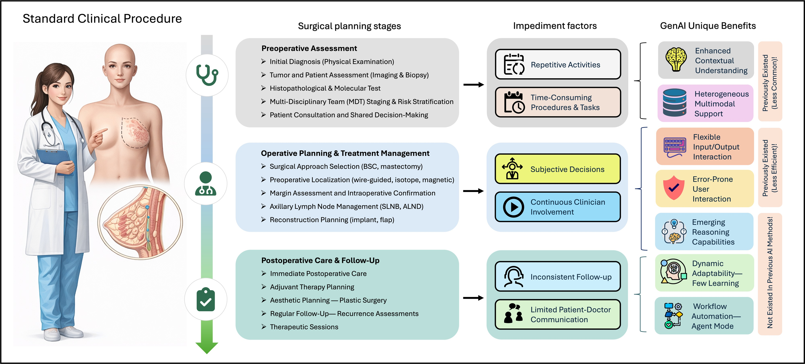

This figure maps the clinical continuum into **preoperative**, **operative**, and **postoperative** phases, while also highlighting where GenAI may reduce repetitive documentation, synthesize multi-source evidence, support reasoning, and improve patient communication.

### Why GenAI instead of only conventional AI?

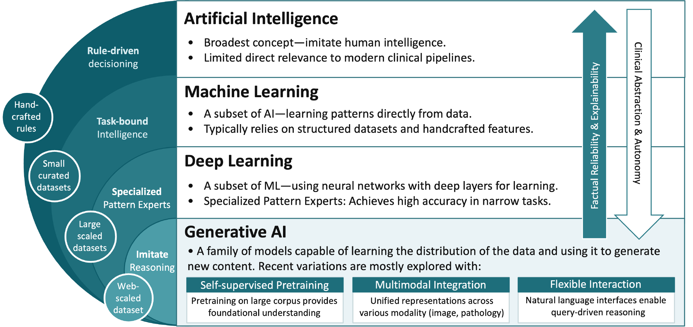

The manuscript positions GenAI as a clinically relevant extension of prior ML/DL pipelines, particularly because of its potential for:
- multimodal contextual integration,
- flexible language-based interaction,
- reasoning-driven adaptation across timepoints, and
- agentic support for multi-step workflow automation.

---

## Research questions and evidence-analytics framework

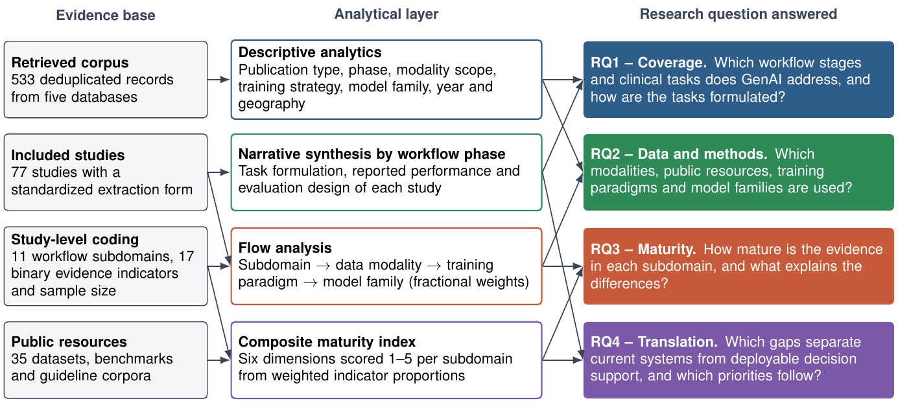

The review answers four research questions, each linked to the evidence layer and the analysis that answers it:

| RQ | Question | Evidence and analysis | Manuscript sections |
|---|---|---|---|
| **RQ1 – Coverage** | Which stages and subdomains of the breast cancer surgical workflow have GenAI studies addressed, and how are the underlying clinical tasks formulated (extraction, generation, recommendation, simulation)? | Descriptive analytics of the 533 deduplicated records; phase-wise narrative synthesis of the 77 included studies | Overview 4.2; Results by workflow phase 5.1–5.3 |
| **RQ2 – Data and methods** | Which data modalities, public resources, training paradigms, and model families underpin these applications, and how do they combine along the workflow? | `11_study_coding/method_coding.csv`, `11_study_coding/public_datasets.csv`, Sankey flow analysis | Overview 4.3–4.4 |
| **RQ3 – Maturity** | How mature is the evidence in each subdomain (patient-centeredness, grounding and faithfulness, data availability, technical maturity, workflow integration, clinical validation), and what explains the differences? | `11_study_coding/study_coding.csv`, composite maturity index, radar profiles and evidence matrix, sensitivity analyses | Results 5.4, Discussion 6.1, Appendix A |
| **RQ4 – Translation** | Which gaps separate current systems from deployable, workflow-integrated decision support, and which priorities follow for clinicians, developers, and healthcare organizations? | All of the above | Discussion 6.2, Open challenges and research agenda 7, Conclusions 9 |


The answers to the four research questions, summarized at the start of the Conclusions of the manuscript, are shown below.

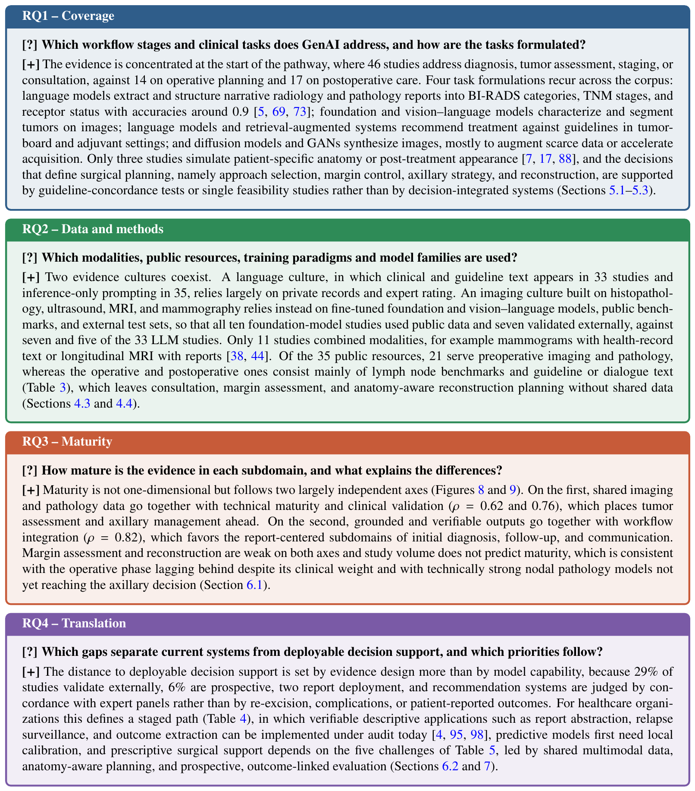

### Objectives distilled from the manuscript

The repository supports the following review objectives:
- systematically identify and categorize current **GenAI use-cases** in breast surgical planning;
- analyze the field across **algorithm families, training strategies, data modalities, and workflow stage**;
- document the literature selection pipeline in a **fully auditable, machine-readable** form;
- prioritize studies using both **distribution-aware algorithmic ranking** and **human qualitative review**;
- expose limitations related to **data availability, validation heterogeneity, interpretability, privacy, and clinical deployment**; and
- support future extensions of the review through reusable stage-wise artifacts.

---

## Search strategy and literature retrieval

### Databases and source coverage

To capture both clinical and technical literature, the search strategy targeted multiple repositories used in the manuscript:
- **Scopus**,
- **PubMed**,
- **IEEE Xplore**,
- **Semantic Scholar**, and
- **arXiv**.

The raw retrieved set is stored in:

```text
01_articles_per_source/articles.csv
```

This file preserves the source-level origin of each record and functions as the **identification-stage entry point** for the full PRISMA-style screening workflow.

### Raw retrieval schema

`01_articles_per_source/articles.csv`

```text
title,authors,abstract,year,repo_origin
```

### Search logic used in the review

The search strategy combines a **clinical axis** (breast + surgical planning) with a **GenAI axis** (foundation models, LLMs, VLMs, agentic systems, and related terminology).

```text
TITLE-ABS-KEY (
  (
    (("breast" OR "mammary") AND "surgical planning")
    AND
    (
      "generative artificial intelligence"
      OR "generative AI"
      OR "generative models"
      OR "foundation model"
      OR "large language model"
      OR "vision language model"
      OR "genai"
      OR "LLM"
      OR "VLM"
      OR "agentic models"
    )
  )
)
AND PUBYEAR > 2019
```

This query design intentionally favors **high recall** within the intersection of **breast surgical planning** and **modern generative / foundation-model research**.

### Repository-level distribution

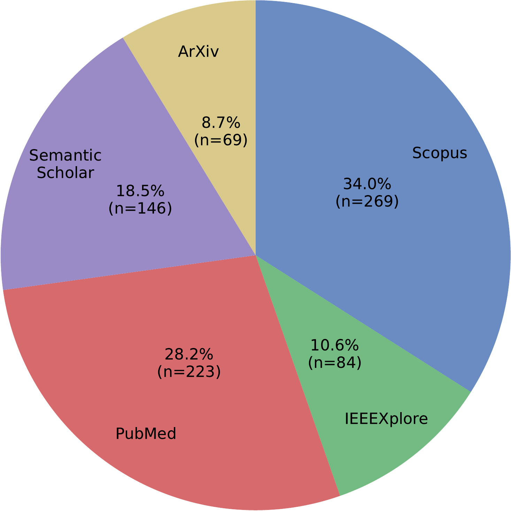

This figure summarizes how much each search source contributed to the retrieved corpus. In the manuscript, Scopus and PubMed provide the largest share, with IEEE Xplore, Semantic Scholar, and arXiv contributing complementary cross-domain and emerging work.

### Vocabulary check of the retrieved corpus

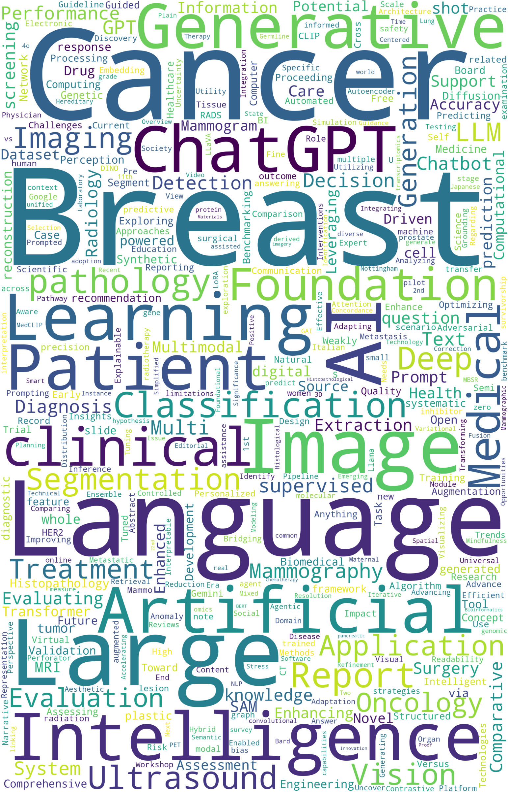

The word cloud is used in the paper as a sanity check that the identification-stage corpus actually captures the intended intersection between:
- **clinical terms** such as breast, cancer, surgery, planning, and treatment; and
- **methodological terms** such as model, language, multimodal, image, and learning.

### Conceptual structure after screening

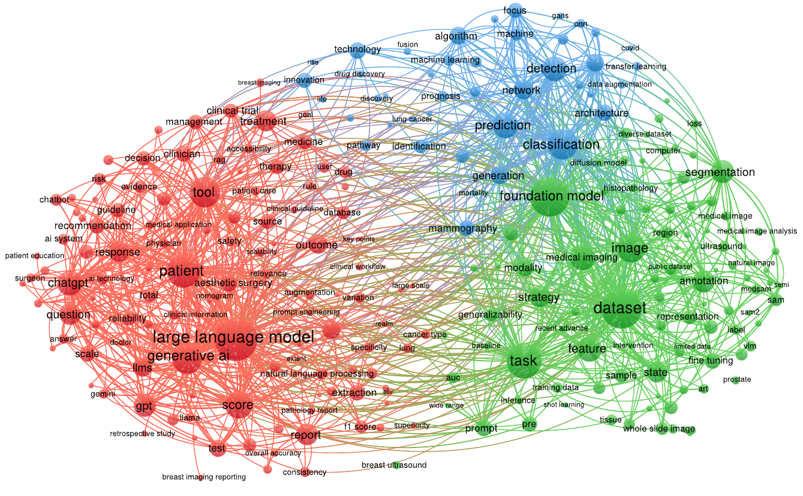

The co-occurrence network in the manuscript shows how the screened literature organizes into interacting clusters around:
- LLM-based clinical reasoning and decision support,
- imaging / foundation-model pipelines,
- and technical GenAI methods for prediction, segmentation, and multimodal integration.

---

## PRISMA-style screening workflow

The screening process follows the stage order represented below.

**Identification → Study categorization → Title screening → Abstract screening → Full-text screening → Qualitative ranking → Final candidate set → Summarization**

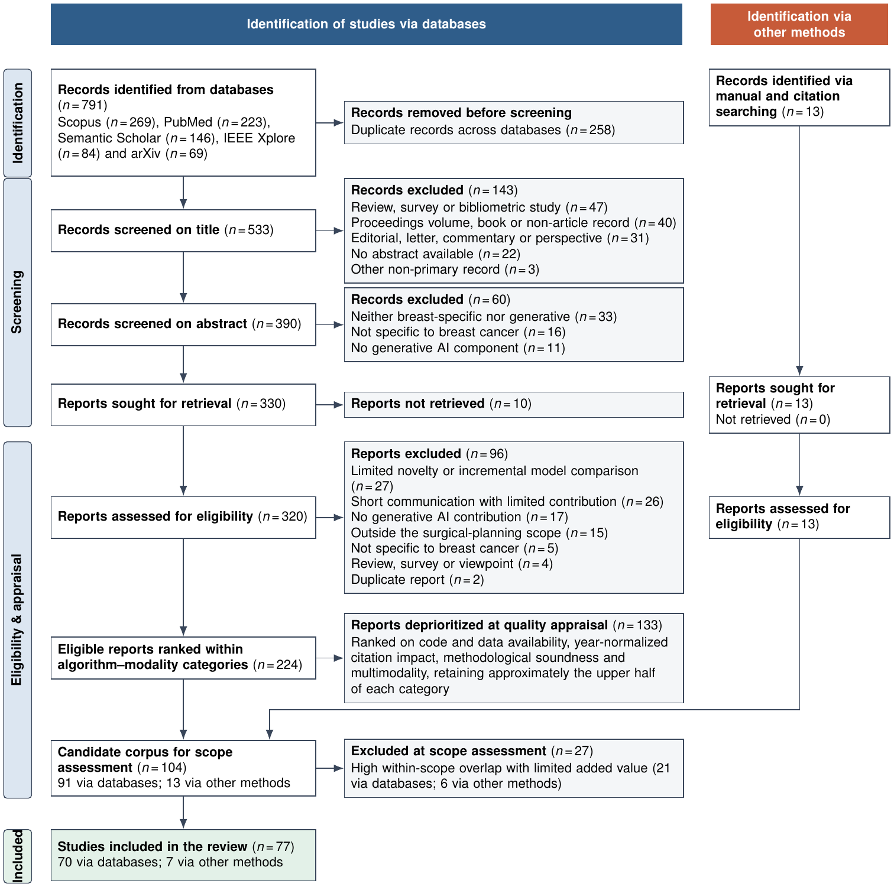

The PRISMA 2020 flow reports the identification of 791 database records (Scopus 269, PubMed 223, Semantic Scholar 146, IEEE Xplore 84, arXiv 69) and 13 records from manual and citation searching, the removal of 258 duplicates, title screening (−143), abstract screening (−60), retrieval (10 reports not retrieved), full-text eligibility (−96), quality-based prioritization within algorithm–modality categories (−133), and the scope assessment of the 104 candidates (−27), which yields **77 included studies** (70 via databases, 7 via other methods). The exclusion-reason categories shown in the diagram are assigned to every excluded record in `prisma/10_prisma_flow/exclusion_reasons_categorized.csv` by `Code/categorize_exclusions.py`, and the diagram source is `prisma/10_prisma_flow/prisma2020.tex`.

A key design choice in this repository is that each stage produces explicit machine-readable files for:
- the **marked full stage output**,
- the **accepted subset**, and
- the **rejected subset with reasons**.

This makes the review pipeline inspectable, reversible, and easy to extend.

### Study eligibility logic used across the pipeline

The manuscript applies the following inclusion and exclusion logic.

| Category | Criterion | Description |
|---|---|---|
| **General** | Timeline | Published from 2020 to the search date (20 November 2025) |
| **General** | Language | Full text available in English |
| **General** | Scope | Intersection of GenAI and breast surgical planning |
| **Publication** | Venue | Peer-reviewed journal and conference papers |
| **Publication** | Access | Open access and subscription (no filter) |
| **Screening** | Title | Clear contribution to GenAI-based breast surgical planning |
| **Screening** | Abstract | Generative or foundation-model focus (not conventional ML/DL) |
| **Screening** | Clinical | Breast-specific (not general clinical disciplines) |
| **Screening** | Full text | Substantive contribution to a task within the surgical workflow |
| **Quality metrics** | Code | Public code repository prioritized |
| **Quality metrics** | Data | Public dataset prioritized |
| **Quality metrics** | Citation | Higher citation count relative to publication year |
| **Quality metrics** | Method | Clear contribution, sound methodology, adequate evaluation |
| **Quality metrics** | Modality | Multimodal design prioritized |

As in the manuscript, GenAI is understood broadly: language models used for extraction or classification, vision–language models such as CLIP-based systems, and promptable foundation models such as the segment anything model are eligible alongside diffusion models, GANs, and retrieval-augmented systems.

### How the repository maps to the manuscript

The repository is organized to mirror the methodology and evidence-synthesis workflow described in the manuscript, from literature retrieval and PRISMA screening to qualitative assessment, final corpus construction, and manuscript writing support.

| Manuscript component | Main repository artifacts |
|---|---|
| **Search strategy and literature retrieval** | `01_articles_per_source/articles.csv`, `02_study_categorization/articles_categorized.csv`, `figs/search_query.png`, `figs/repo_dist.png`, `figs/wordcloud.png`, `figs/graph.png` |
| **PRISMA workflow and screening methodology** | `03_title_screening/`, `04_abstract_screening/`, `05_fulltext_screening/`, `figs/prisma2020.png`, `10_prisma_flow/` |
| **Eligibility criteria and corpus refinement** | Stage-wise screening logs (`03_*`, `04_*`, `05_*`), `09_confirmed_prisma/rejected_by_scope_assessment.csv` |
| **Descriptive statistical analysis** | `02_study_categorization/articles_categorized.csv`, `figs/general_stat.png`, `figs/world_map.png`, `figs/three_pies.png`, `figs/data_vs_train.png`, `figs/algorithm_share_by_year.png` |
| **Dataset and resource analysis** | `11_study_coding/public_datasets.csv`, `08_summarized_texts/reviews_summarized.xlsx`, `08_summarized_texts/reviews_summarized.csv` |
| **Keyword and thematic structure analysis** | `figs/wordcloud.png`, `figs/graph.png` |
| **Algorithmic study prioritization** | `06_qualitive_ranking/algorithmic_ranking/algorithmic_qa_script.py`, `algorithmic_qa_articles.csv`, `algorithmic_qa_report.md` |
| **Human qualitative assessment** | `06_qualitive_ranking/human_qa_analysis.csv`, `06_qualitive_ranking/candidate_articles.md` |
| **Candidate-paper selection** | `07_candidate_papers/systematic_search.csv`, `07_candidate_papers/manual_search.csv`, `07_candidate_papers/candidate_and_manual.bib` |
| **Evidence extraction and manuscript writing support** | `08_summarized_texts/reviews_summarized.xlsx`, `08_summarized_texts/reviews_summarized.csv`, `08_summarized_texts/Review-Instructions.md` |
| **Composite maturity index** | `11_study_coding/study_coding.csv`, `11_study_coding/subdomain_indicators.csv`, `11_study_coding/subdomain_scores.csv`, `Code/compute_index.py`, `figs/radar_phases.png`, `figs/evidence_matrix.png` |
| **Sensitivity analyses (Appendix A)** | `Code/eligible_vs_included.py`, `Code/sensitivity_analyses.py`, `11_study_coding/eligible_vs_included.csv`, `11_study_coding/index_weight_perturbation.csv`, `11_study_coding/index_bootstrap_ci.csv`, `11_study_coding/index_leave_one_out.csv`, `11_study_coding/index_axis_correlations.csv` |
| **Study-level evidence indicators** | `11_study_coding/study_coding.csv`, [table below](#study-level-evidence-indicators) |
| **Workflow-wide landscape analysis** | `11_study_coding/method_coding.csv`, `Code/sankey_final77.py`, `figs/sankey.png` |
| **Final confirmed review corpus** | `09_confirmed_prisma/confirmed_prisma.csv` |
| **Supporting clinical and related-work references** | `09_confirmed_prisma/supplementary_clinical_work.csv`, `09_confirmed_prisma/supplementary_related_work.csv` |
| **Discussion, limitations, and future directions** | `09_confirmed_prisma/confirmed_prisma.csv`, `08_summarized_texts/reviews_summarized.xlsx`, `figs/sankey.png`, `figs/radar_phases.png`, `figs/evidence_matrix.png` |
| **Final narrative synthesis and conclusions** | `09_confirmed_prisma/confirmed_prisma.csv`, `07_candidate_papers/candidate_and_manual.bib`, `08_summarized_texts/reviews_summarized.xlsx` |

### Mapping to the manuscript structure

| Manuscript section | Primary repository support |
|---|---|
| **1 Introduction** (incl. 1.1 Distinguishing factors) | `09_confirmed_prisma/supplementary_related_work.csv`, `09_confirmed_prisma/supplementary_methodological_and_context.csv`, `figs/genai.png`, `figs/framework.png` |
| **2 Clinical background** | `09_confirmed_prisma/supplementary_clinical_work.csv`, `figs/clinical_workflow.png` |
| **3 Methods** (search, eligibility, selection, appraisal, extraction, evidence analytics, maturity index) | `01_articles_per_source/` to `07_candidate_papers/`, `09_confirmed_prisma/`, `10_prisma_flow/`, `11_study_coding/CODEBOOK.md`, `Code/compute_index.py`, `figs/prisma2020.png`, `figs/search_query.png` |
| **4 Overview of the evidence base** (selection, retrieved corpus, included studies, public datasets) | `02_study_categorization/articles_categorized.csv`, `11_study_coding/method_coding.csv`, `11_study_coding/public_datasets.csv`, `figs/general_stat.png`, `figs/world_map.png`, `figs/three_pies.png`, `figs/data_vs_train.png`, `figs/algorithm_share_by_year.png`, `figs/graph.png`, `figs/sankey.png` |
| **5 Results by workflow phase** (preoperative, operative, postoperative, maturity) | `09_confirmed_prisma/confirmed_prisma.csv`, `08_summarized_texts/reviews_summarized.xlsx`, `11_study_coding/subdomain_scores.csv`, `figs/radar_phases.png`, `figs/evidence_matrix.png` |
| **6 Discussion** | `11_study_coding/subdomain_scores.csv`, `11_study_coding/index_axis_correlations.csv` |
| **7 Open challenges and research agenda** | `11_study_coding/study_coding.csv`, `11_study_coding/public_datasets.csv` |
| **8 Threats to validity** | `06_qualitive_ranking/`, `09_confirmed_prisma/rejected_by_scope_assessment.csv`, `11_study_coding/eligible_vs_included.csv` |
| **9 Conclusions** (answers to the research questions) | `figs/research-questions.png` |
| **Appendix A** – Sensitivity analyses | `Code/eligible_vs_included.py`, `Code/sensitivity_analyses.py`, `11_study_coding/eligible_vs_included.csv`, `11_study_coding/index_*.csv` |
| **Study-level evidence indicators** (referenced in Section 3.5) | `11_study_coding/study_coding.csv`, [table below](#study-level-evidence-indicators) |

The overall workflow implemented by the repository follows:

**Identification → Categorization → Title Screening → Abstract Screening → Full-Text Review → Algorithmic Ranking → Human Qualitative Assessment → Candidate Corpus Construction → Evidence Extraction → Scope Assessment → Confirmed PRISMA Corpus → Study-Level Coding → Evidence Analytics → Manuscript Synthesis**

---

## Stage-wise repository artifacts

This section documents the actual folder structure and the role of every file in the review pipeline.

### 1) Identification

**Folder**

```text
01_articles_per_source/
```

**Files**

| File | Purpose | Columns |
|---|---|---|
| `articles.csv` | Raw merged retrieval set from all repositories | `title, authors, abstract, year, repo_origin` |

This stage is intentionally **recall-oriented**. No paper is excluded for scientific reasons here; the aim is to preserve breadth before screening.

---

### 2) Study categorization

**Folder**

```text
02_study_categorization/
```

**Files**

| File | Purpose | Columns |
|---|---|---|
| `articles_categorized.csv` | Enriched metadata used for downstream filtering, distributions, and ranking | `title, abstract, publication_date, authors, keywords, document_type, affiliation, algorithm, training_technology, journal_categorization, medical_goal, country, continent, modality_reference, modality_type, modality_count` |

This file is the first major **organization layer** of the corpus. It turns the raw retrieval set into a structured dataset that can be analyzed by:
- algorithm family,
- training strategy,
- clinical goal,
- geography,
- modality,
- modality type,
- and unimodal vs multimodal design.

---

### 3) Title screening

**Folder**

```text
03_title_screening/
```

**Files**

| File | Purpose | Columns |
|---|---|---|
| `title_screened_marked.csv` | Full title-screening log with inclusion flag and rejection reason | `title, abstract, publication_date, authors, keywords, rejected_by_title_screening, title_screening_reason` |
| `articles_rejected_by_title_screening.csv` | Papers rejected at title stage | `title, abstract, publication_date, authors, keywords, title_screening_reason` |
| `articles_after_title_screening.csv` | Papers retained for abstract screening | `title, abstract, publication_date, authors, keywords` |

This is the **first relevance filter**. It removes studies that are obviously outside the review scope while keeping ambiguous cases for deeper inspection.

---

### 4) Abstract screening

**Folder**

```text
04_abstract_screening/
```

**Files**

| File | Purpose | Columns |
|---|---|---|
| `abstract_screened_marked.csv` | Full abstract-screening log with inclusion flag and rejection reason | `title, abstract, publication_date, authors, keywords, rejected_by_abstract_screening, abstract_screening_reason` |
| `articles_after_abstract_screening.csv` | Papers retained for full-text review | `title, abstract, publication_date, authors, keywords` |
| `articles_rejected_by_abstract_screening.csv` | Papers rejected after abstract inspection | `title, abstract, publication_date, authors, keywords, abstract_screening_reason` |

At this stage, papers are checked for:
- real methodological relevance,
- explicit connection to breast surgical planning,
- and whether the abstract actually supports inclusion beyond keyword overlap.

---

### 5) Full-text screening

**Folder**

```text
05_fulltext_screening/
```

**Files**

| File | Purpose | Columns |
|---|---|---|
| `fulltext_review_marked.csv` | Full full-text review log with decision flag and reason | `title, path_to_fulltext, rejected_by_fulltext_review, fulltext_review_reason` |
| `articles_after_fulltext_review.csv` | Papers retained after full-text review | `title, path_to_fulltext` |
| `articles_rejected_by_fulltext_review.csv` | Papers rejected at full-text stage | `title, path_to_fulltext, fulltext_review_reason` |

This stage verifies that the **full article** actually supports what the title and abstract suggest. Typical exclusion reasons here involve insufficient novelty, weak alignment with the paper’s scope, or limited methodological substance for comparative synthesis.

---

### 6) Qualitative ranking and prioritization

**Folder**

```text
06_qualitive_ranking/
```

> The folder name is preserved exactly as used in the repository.

This stage contains both **algorithmic prioritization** and **human review**, making it the bridge between the screened corpus and the final candidate-paper set.

#### 6.1) Algorithmic ranking subfolder

**Path**

```text
06_qualitive_ranking/algorithmic_ranking/
```

**Files**

| File | Purpose |
|---|---|
| `algorithmic_qa_script.py` | Distribution-aware ranking script used to generate a balanced shortlist |
| `algorithmic_qa_report.md` | Text report describing the selection statistics and balance checks |
| `algorithmic_qa_articles.csv` | Ranked / selected subset used as algorithmic shortlist |

#### Algorithmic input schema

`algorithmic_qa_articles.csv`

```text
title,abstract,publication_date,authors,citations,keywords,algorithm,training_technology,medical_goal,modality_reference,modality_type,modality_count
```

#### What the ranking script actually does

The script is not a generic top-citation filter. It performs a **distribution-aware selection of 75 of the 224 eligible studies**, drawn from every category in proportion to its size, by balancing:
- **algorithm family**,
- **training technology**,
- **medical goal**,
- **reference modality**,
- **modality type**, and
- **unimodal vs multimodal coverage**.

It also introduces **rare-theme preservation** by detecting low-frequency but strategically important themes such as:
- RAG,
- reinforcement learning,
- federated learning,
- NeRF / 3D,
- knowledge graphs,
- explainability,
- OOD / anomaly detection,
- privacy / security,
- and drug-discovery links.

When no dedicated manual quality score is available, the script falls back to:
- `log1p(citations)` if citation counts exist,
- or zero-valued fallback otherwise.

#### Snapshot of the algorithmic selection report

According to `algorithmic_qa_report.md`:
- **224** rows entered the ranking step,
- **75** were selected,
- the quality proxy used was `__auto_quality__`,
- and the fallback mode was `AUTO_FALLBACK=citations_log1p`.

The shortlist reproduces the eligible distribution of algorithm families, training technologies, and medical goals to within 2.5 percentage points. The reviewers then compared the shortlist with the complete ranked list of each category and confirmed **91 studies**, each with a recorded justification in `human_qa_analysis.csv`.

##### Distribution highlights from the report

| Dimension | Dominant selected categories |
|---|---|
| **Algorithm** | LLM (**45.33%**), VLM (**18.67%**), Backbone / foundational (**16.00%**), Diffusions/GANs (**13.33%**) |
| **Training technology** | Supervised fine-tuning (**45.33%**), in-context learning / inference (**38.67%**), synthetic data generation (**10.67%**) |
| **Medical goal** | Pre-surgery & treatment planning (**89.33%**) |
| **Modality type** | Text-only (**44.00%**), Imaging-only (**30.67%**), Image-text (**25.33%**) |
| **Modality count** | Unimodality (**66.67%**), Multimodal (**33.33%**) |

##### Rare-theme preservation reported by the script

| Rare theme | Count in full set | Count in selected set |
|---|---:|---:|
| `theme_rl` | 1 | 1 |
| `theme_nerf_3d` | 3 | 1 |
| `theme_knowledge_graph` | 4 | 1 |
| `theme_federated` | 5 | 2 |
| `theme_ood_anomaly` | 5 | 2 |

This matters because the final shortlist is designed to remain **representative** while still preserving less frequent but clinically or methodologically important directions.

#### 6.2) Human qualitative assessment

**Files**

| File | Purpose | Columns |
|---|---|---|
| `human_qa_analysis.csv` | Reviewer-authored rationale for why candidate studies were kept | `title, algorithm_modality_bucket, reason_for_selection` |
| `candidate_articles.md` | Structured narrative shortlist grouped by method family / theme | Markdown document |

The human QA layer adds what the algorithmic pass cannot capture reliably on its own:
- clinical relevance,
- novelty,
- translational importance,
- evaluation quality,
- and usefulness for the paper’s narrative synthesis.

#### Candidate buckets recorded in `candidate_articles.md`

The 91 confirmed studies are grouped into the following thematic buckets:

| Bucket | Count |
|---|---:|
| Large Language Model (LLM) studies | 39 |
| Vision–Language-Model (VLM) studies | 12 |
| Backbone / foundational model studies | 12 |
| Diffusions / GANs studies | 8 |
| RAG studies | 6 |
| Agentic frameworks | 4 |
| Drug discovery studies | 4 |
| Explainability, auditability, and safety | 4 |
| 3D / volumetric studies | 2 |

This markdown file is particularly useful when writing the **Results** and **Discussion** sections, because it already groups the shortlisted literature into manuscript-friendly themes with reviewer rationales.

---

### 7) Final candidate-paper set

**Folder**

```text
07_candidate_papers/
```
**Files**

| File | Purpose |
|---|---|
| `systematic_search.csv` | Final machine-readable list of candidate papers retrieved from the repositories systematically and are selected for review with columns: `title`, `path_to_fulltext`, `bibtex_to_cite`, `abstract`, `publication_date`, `authors`, `keywords` |
| `manual_search.csv` |  Final machine-readable list of candidate papers selected manually with columns: `title`, `path_to_fulltext`, `bibtex_to_cite`, `abstract`, `publication_date`, `reason_for_inclusion`, in which the reason for utilizing those selected papers are presented as well. |
| `candidate_and_manual.bib` | This bibtex file is the summation of all manual and repo papers |

---

### 8) Summarized texts and writing support material

**Folder**

```text
08_summarized_texts/
```

> This directory is reserved for the detailed article summaries used to support section writing, cross-paper comparisons, evidence tables, and the final narrative synthesis.

Typical uses of this folder include:
- the review notes extracted from all the candidate papers, organized in `reviews_summarized.xlsx` with one sheet per topic (`LLM`, `RAG-Agentic`, `VLM`, `Diffiusions`, `Mixed`, `Foundation models`, `Manual`, and `Related work`),
- For each record, the summary is organized into `title`, `path_to_fulltext`, `bibtex_to_cite`, `Summary of the paper (highlighting novelty & goals)`, `Datasets names (also is public or private)`, `Baseline model/architecture`, `Training Approach`, `Medical Phase (pre/post)`, `Medical Modality`, `Model input modality`, `Evaluation Metric & corresponding value` which makes it a detailed, but maintainable representation for future assessment,
- the metadata behind the earlier exploratory radar material (`figs/ranking_matrix.png`, `figs/radar_plot_2d.png`), which the composite maturity index has since replaced.

**Files**

| File | Purpose |
|---|---|
| `reviews_summarized.xlsx` | An excel file with 8 sheets each has columns: `title`, `path_to_fulltext`, `bibtex_to_cite`, `Summary of the paper (highlighting novelty & goals)`, `Datasets names (also is public or private)`, `Baseline model/architecture`, `Training Approach`, `Medical Phase (pre/post)`, `Medical Modality`, `Model input modality`, `Evaluation Metric & corresponding value`, where each sheet covers one group of works (`LLM`, `RAG-Agentic`, `VLM`, `Diffiusions`, `Mixed`, `Foundation models`, `Manual`, and `Related work`). |
| `reviews_summarized.csv` | A machine-readable csv with the contents of `reviews_summarized.xlsx` |
| `Review-Instructions.md` | Instructions for all the co-authors on the review criteria |
| `radar_plot.csv` | Metadata behind the earlier exploratory radar material (`figs/ranking_matrix.png`, `figs/radar_plot_2d.png`), kept for reference. |


### 9) Confirmed PRISMA

**Folder**

```text
09_confirmed_prisma/
```

> This directory holds the final included corpus, the candidates removed by the scope assessment, and the supporting references used in the manuscript.

Typical uses of this folder include:
- final list of summarized records noted as `confirmed_prisma.csv` with all the detailed reviews,
- final list of excluded records with the `reason_for_exclusion` column noting why they have been removed. However, it must be noted that the summary of the paper is still intact in `rejected_by_scope_assessment.csv` for future use-cases and inspections,
- list of supplementary files used for clinical discussions (`supplementary_clinical_work.csv`) used in this work. Furthermore, the related surveys that are used for showcasing the distinguishing factors of our work are also included in `supplementary_related_work.csv`, and the methodological standards and Healthcare Analytics context references are listed in `supplementary_methodological_and_context.csv`.

The scope assessment asked, for each of the 104 candidates, which decision in the surgical workflow it informs and what it adds to the other candidates in the same subdomain. Candidates whose contribution overlapped substantially with another candidate using a comparable task formulation, modality, and evaluation design were excluded, and when several candidates reported closely related work from the same research programme, the most complete report was retained. The resulting 77 included studies comprise 70 from the database search and 7 from manual searching, and every excluded candidate keeps its full summary and the reason for exclusion in `rejected_by_scope_assessment.csv`.

**Files**

| File | Purpose |
|---|---|
| `confirmed_prisma.csv` | A machine-readable csv containing the 77 included studies with their detailed extraction records. |
| `rejected_by_scope_assessment.csv` | A list of all the records removed due to the scope assessment, with also the reasoning for removing each record in `reason_for_exclusion` column.  |
| `supplementary_clinical_work.csv` | The clinical references used in the clinical background of the manuscript. |
| `supplementary_related_work.csv` | A machine-readable csv with the list of articles used for showcasing the distinguishing factors of our work compared with previous surveys in this field.|
| `supplementary_methodological_and_context.csv` | Methodological standards (PRISMA 2020, PROBAST) and the Healthcare Analytics articles that situate the review within healthcare analytics. |


### 10) PRISMA 2020 flow

**Folder**

```text
10_prisma_flow/
```

| File | Purpose |
|---|---|
| `exclusion_reasons_categorized.csv` | Every record excluded at title, abstract, and full-text screening with its recorded reason and the PRISMA category displayed in `figs/prisma2020.png` (`stage, title, recorded_reason, reason_category`) |
| `prisma2020.tex` | TikZ source of the PRISMA 2020 flow diagram used in the manuscript |

### 11) Study-level coding and composite maturity index

**Folder**

```text
11_study_coding/
```

| File | Purpose |
|---|---|
| `study_coding.csv` | Primary and secondary workflow subdomain, 17 binary evidence indicators, and sample size for each of the 77 included studies |
| `method_coding.csv` | Data modalities, training paradigm, and model family of each included study (input of the Sankey diagram) |
| `public_datasets.csv` | The 35 public datasets, benchmarks, and guideline corpora used by the included studies (Table 3 of the manuscript) |
| `subdomain_indicators.csv` | Weighted indicator proportions per subdomain |
| `subdomain_scores.csv` | Six maturity dimension scores (1–5) per subdomain |
| `weight_sensitivity.csv` | Robustness of the subdomain ranking to equal weights within each dimension |
| `index_weight_perturbation.csv` | Rank stability under 10,000 random weight perturbations (Appendix A, Table A.2) |
| `index_bootstrap_ci.csv` | 95% bootstrap intervals of all 66 subdomain scores |
| `index_leave_one_out.csv` | Largest score change when each single study is removed (Table A.2) |
| `index_axis_correlations.csv` | Bootstrap and weight-perturbation stability of the four axis correlations (Table A.3) |
| `eligible_vs_included.csv` | Eligible, prioritized, and included studies compared on the abstract-level categorization (Table A.1) |
| `CODEBOOK.md` | Definitions of every subdomain code, indicator, weight, and method category |

---

## Corpus statistics and descriptive analysis

The paper complements the narrative synthesis with a descriptive analysis of the 533 retrieved records and of the 77 included studies. The figures below are the visual summary of those analyses.

### General corpus statistics

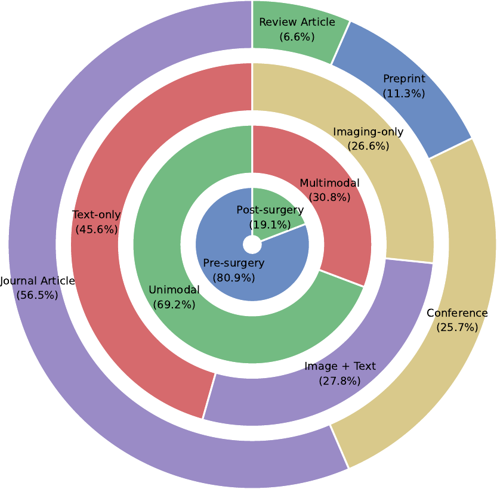

This figure summarizes the literature by publication type, clinical phase, modality design, and unimodal versus multimodal setup.

### Geographic distribution

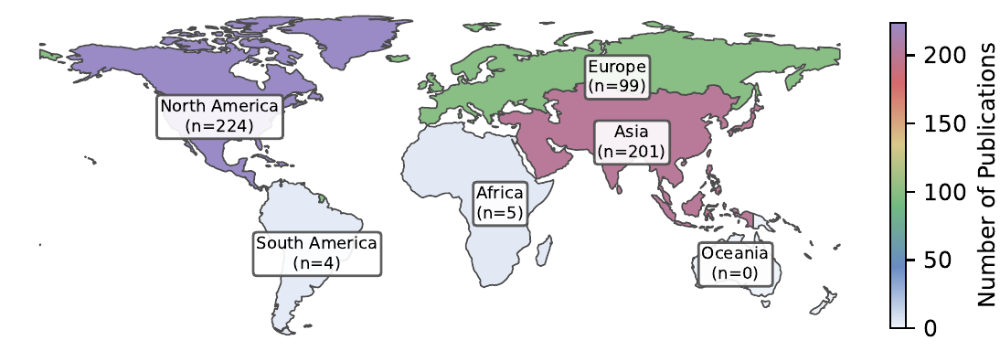

The geographic map shows the concentration of studies across North America, Asia, and Europe, which is important when discussing generalizability, data provenance, and cross-site transferability.

### High-level distribution by method, modality, and scope

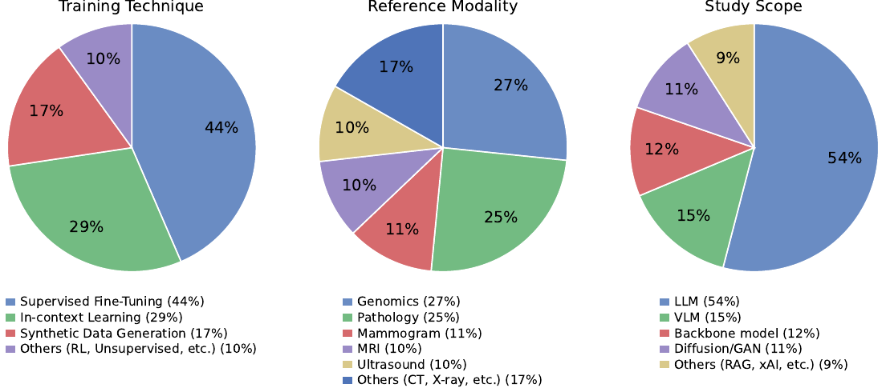

This panel summarizes the evidence base according to:
- training strategy,
- reference modality,
- and study scope / model family.

### Modality versus training-strategy co-occurrence

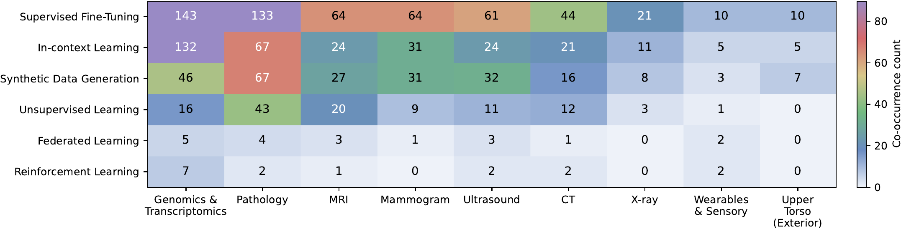

This heatmap helps identify which training approaches dominate which data settings. In the manuscript, supervised fine-tuning and in-context learning dominate the landscape, while federated and reinforcement-learning variants remain sparse.

### Temporal trend in algorithm families

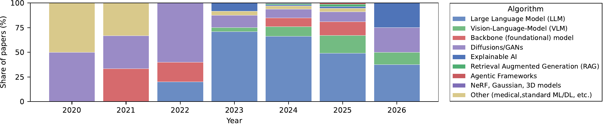

This figure supports one of the central conclusions of the review: the field is shifting from earlier image-generation and narrow-task paradigms toward **LLM-heavy, multimodal, and system-level GenAI pipelines**.

### Workflow-to-algorithm flow of the included studies

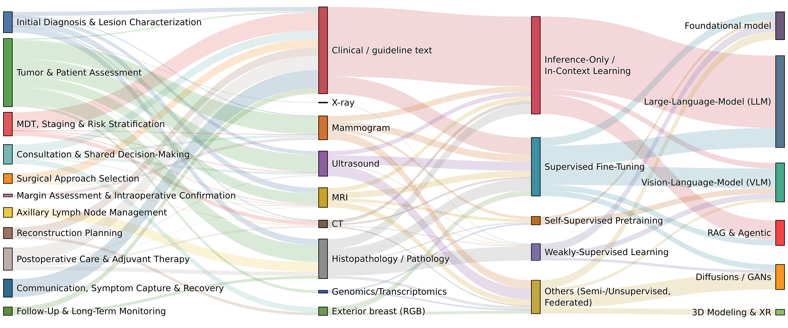

The Sankey diagram traces each of the 77 included studies from its workflow subdomain to its data modality, training paradigm, and model family, with studies that span two subdomains or several modalities assigned fractionally so that every study contributes a total weight of one. It is generated by `Code/sankey_final77.py`, which keeps the plotting code and style of `Code/sankey_plot.ipynb` and reads the assignments from `prisma/11_study_coding/`. Evidence concentrates in tumor and patient assessment and initial diagnosis, and it is carried by two parallel streams: clinical and guideline text processed through inference-only LLM and retrieval-augmented pipelines, and histopathology and radiology images processed through fine-tuned foundation models and vision–language models. Reconstruction, margin assessment, and follow-up remain thin flows that connect to external breast photographs, CT, and 3D modeling.

---

### Composite maturity index: radar profiles and evidence matrix

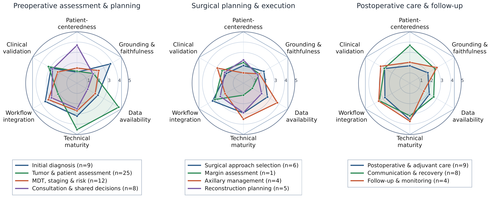
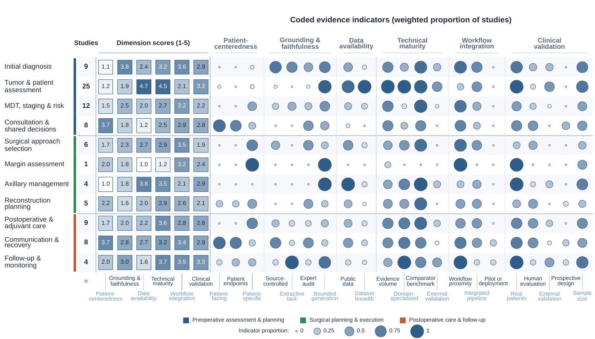

The maturity index is computed directly from the study-level coding in `prisma/11_study_coding/study_coding.csv`:

1. Every included study is coded on **17 binary evidence indicators** (patient-facing application, patient-reported endpoints, individualized output, source-controlled generation, extractive task, expert faithfulness audit, open-ended generation, public data, domain specialization, benchmarking, external validation, workflow proximity, pipeline integration, deployment, real patient data, clinician or patient evaluation, prospective design) and its sample size.
2. A study assigned to *k* subdomains contributes a weight of 1/*k* to each, and the value of each indicator for a subdomain is the **weighted proportion** of its studies exhibiting the property. Bounded generation (1 − open generation), a log-scaled sample-size term, an evidence-volume term, and a dataset-breadth term complete the indicator set.
3. Each of the six dimensions (patient-centeredness, grounding and faithfulness, data availability, technical maturity, workflow integration, clinical validation) is a **fixed weighted sum** of its indicators rescaled to 1–5: `S_d(s) = 1 + 4 * sum_i w_i * x_i(s)`. The weights are listed in `CODEBOOK.md`.
4. Replacing the weights with equal weights within each dimension preserves the ranking of subdomains (Spearman ρ between 0.89 and 1.00; `weight_sensitivity.csv`).

The radar figure groups the eleven subdomains by clinical phase, and the evidence matrix shows, for every subdomain, the six scores (squares) next to the indicator proportions from which they are computed (circles). Both are produced by `Code/make_index_figures.py`. Across subdomains, data availability, technical maturity, and clinical validation move together, whereas grounding moves with workflow integration, which is why imaging-heavy subdomains (tumor assessment, axillary management) and text-heavy subdomains (initial diagnosis, communication, follow-up) mature along different axes, while margin assessment and reconstruction remain weak on both.

The earlier exploratory radar material (`08_summarized_texts/radar_plot.csv`, `figs/radar_plot_2d.png`, `figs/ranking_matrix.png`) is kept for reference.

### Sensitivity analyses (Appendix A)

`Code/sensitivity_analyses.py` (run from `prisma/11_study_coding/`) tests how far the index depends on its weights and on individual studies:

- **Weight perturbation** (`index_weight_perturbation.csv`): 10,000 draws in which every weight is multiplied by a random factor between 0.5 and 1.5 and renormalized; the median rank correlation with the reported scores is 0.96–1.00 across dimensions. A stress test with fully random weights is also reported.
- **Bootstrap resampling** (`index_bootstrap_ci.csv`, `index_axis_correlations.csv`): 2,000 resamples of the 77 included studies give 95% intervals for all 66 subdomain scores; the four associations that define the two axes of maturity keep their sign in more than 99% of resamples.
- **Leave-one-study-out** (`index_leave_one_out.csv`): removing any single study changes a score by at most 0.61 points.

`Code/eligible_vs_included.py` compares the 224 eligible, 91 prioritized, and 70 included database studies on the abstract-level categorization of `02_study_categorization/articles_categorized.csv` (`eligible_vs_included.csv`).

### Study-level evidence indicators

The table lists, for each of the 77 included studies, the evidence indicators coded in `prisma/11_study_coding/study_coding.csv` that describe how its results were obtained and tested. Studies are grouped by primary workflow subdomain; ✓ marks a study that reports the feature, and – marks a study without a reported patient sample. *Real patients*: real clinical data rather than synthetic or benchmark-only data; *Human evaluation*: outputs assessed by clinicians or patients; *Expert audit*: factual faithfulness verified by experts; *Comparator*: benchmarked against other models or human baselines; *External validation*: external, temporal, or multi-site testing; *Prospective* and *Deployment*: prospective design and pilot, trial, or live use. The remaining indicators of the maturity index are in the same file.

| Study | Real patients | Public data | Sample size | Human evaluation | Expert audit | Comparator | External validation | Prospective | Deployment |
|---|:-:|:-:|--:|:-:|:-:|:-:|:-:|:-:|:-:|
| **Preoperative – Initial diagnosis and lesion characterization (9)** | | | | | | | | | |
| Çamur et al. (2025) |  | ✓ | 240 |  |  | ✓ |  |  |  |
| Chen et al. (2025) | ✓ |  | 501 | ✓ | ✓ | ✓ | ✓ |  |  |
| Choi et al. (2023) | ✓ |  | 2,931 |  |  | ✓ |  |  |  |
| Hein et al. (2025) | ✓ | ✓ | 2,350 |  | ✓ | ✓ | ✓ |  |  |
| Huh et al. (2026) | ✓ | ✓ | 750 | ✓ |  | ✓ |  |  |  |
| Liu et al. (2025) | ✓ |  | 16,927 |  |  | ✓ | ✓ |  |  |
| Sanli et al. (2025) | ✓ |  | 352 |  |  |  |  |  |  |
| Sushil et al. (2024) | ✓ |  | 769 |  | ✓ | ✓ |  |  |  |
| Tayebi Arasteh et al. (2025) |  | ✓ | 104 | ✓ | ✓ | ✓ |  |  |  |
| **Preoperative – Tumor and patient assessment (25)** | | | | | | | | | |
| Cao et al. (2025) | ✓ |  | 30,495 | ✓ | ✓ | ✓ | ✓ |  |  |
| Chen et al. (2024) | ✓ | ✓ | 754 |  |  | ✓ |  |  |  |
| Chen et al. (2025) | ✓ | ✓ | 1,007 |  |  | ✓ | ✓ |  |  |
| Chen et al. (2025) | ✓ | ✓ | 165 |  |  | ✓ | ✓ |  |  |
| Chen et al. (2025) | ✓ | ✓ | 7,039 |  |  | ✓ | ✓ |  |  |
| Gao et al. (2025) | ✓ | ✓ | 1,420 |  |  | ✓ | ✓ |  |  |
| Ghosh et al. (2024) | ✓ | ✓ | 13,829 |  |  | ✓ | ✓ |  |  |
| Huang et al. (2026) | ✓ | ✓ | 500 |  |  | ✓ | ✓ |  |  |
| Kim et al. (2025) | ✓ | ✓ | 496 |  |  | ✓ | ✓ |  |  |
| Koleilat et al. (2025) | ✓ | ✓ | 943 |  |  | ✓ | ✓ |  |  |
| Lee et al. (2025) | ✓ | ✓ | 5,000 |  |  | ✓ | ✓ |  |  |
| Miao et al. (2024) | ✓ | ✓ | 647 |  |  | ✓ |  |  |  |
| Nakka (2025) | ✓ | ✓ | 5,000 |  |  | ✓ |  |  |  |
| Okolie et al. (2025) | ✓ |  | 5,086 | ✓ |  |  |  |  |  |
| Osorio et al. (2024) | ✓ | ✓ | 10,000 | ✓ |  | ✓ |  |  |  |
| Raheem et al. (2025) | ✓ | ✓ | 1,193 |  |  | ✓ | ✓ |  |  |
| Rasaee et al. (2025) | ✓ | ✓ | 5,000 |  |  | ✓ | ✓ |  |  |
| Rofena et al. (2025) | ✓ | ✓ | 204 |  |  | ✓ |  |  |  |
| Vo et al. (2025) | ✓ | ✓ | 3,000 |  |  | ✓ |  |  |  |
| Wang et al. (2024) | ✓ | ✓ | 60,530 |  |  | ✓ | ✓ |  |  |
| Wang et al. (2025) | ✓ | ✓ | 400 |  |  | ✓ |  |  |  |
| Xu et al. (2025) | ✓ | ✓ | 647 |  |  | ✓ |  |  |  |
| Yan et al. (2025) | ✓ | ✓ | 3,000 |  |  | ✓ | ✓ |  |  |
| Zama et al. (2023) | ✓ |  | 1,008 | ✓ |  | ✓ |  |  |  |
| Zhao et al. (2024) | ✓ | ✓ | 933 |  |  | ✓ |  |  |  |
| **Preoperative – MDT evaluation, staging, and risk stratification (6)** | | | | | | | | | |
| Belligoli et al. (2025) |  | ✓ | 50 |  | ✓ | ✓ |  |  |  |
| Delourme et al. (2024) | ✓ |  | 230 |  |  | ✓ |  |  |  |
| Griewing et al. (2023) |  |  | 20 |  |  | ✓ |  |  |  |
| Li et al. (2025) | ✓ |  | 1,201 |  |  | ✓ |  |  |  |
| Miao et al. (2025) | ✓ |  | 45 | ✓ |  | ✓ |  |  |  |
| Spitzl et al. (2025) |  |  | 111 |  |  | ✓ |  |  |  |
| **Preoperative – Consultation and shared decision-making (6)** | | | | | | | | | |
| Maroncelli et al. (2024) | ✓ |  | 21 | ✓ | ✓ |  |  | ✓ |  |
| Montenegro et al. (2025) | ✓ |  | 7,666 |  |  | ✓ |  |  |  |
| Park et al. (2025) |  |  | 20 | ✓ | ✓ |  |  |  |  |
| Pisarcik et al. (2025) |  |  | 40 | ✓ | ✓ | ✓ |  | ✓ |  |
| Santos et al. (2025) | ✓ |  | 1,038 |  |  | ✓ |  |  |  |
| Selvaraj et al. (2026) | ✓ |  | 287 |  |  | ✓ |  |  |  |
| **Operative – Surgical approach selection (5)** | | | | | | | | | |
| Allison et al. (2020) | ✓ |  | – |  |  |  |  |  |  |
| Griewing et al. (2024) |  | ✓ | 100 |  | ✓ | ✓ |  |  |  |
| Mansoor et al. (2025) |  | ✓ | 16 | ✓ | ✓ | ✓ |  |  |  |
| Nabieva et al. (2024) |  | ✓ | 127 |  |  | ✓ |  |  |  |
| Umihanic et al. (2025) | ✓ |  | 91 | ✓ | ✓ | ✓ |  |  |  |
| **Operative – Margin assessment and intraoperative confirmation (1)** | | | | | | | | | |
| Andras et al. (2025) | ✓ |  | 100 |  |  |  |  |  |  |
| **Operative – Axillary lymph node management (3)** | | | | | | | | | |
| Ferber et al. (2024) | ✓ | ✓ | 120 |  |  | ✓ |  |  |  |
| Ling et al. (2025) | ✓ | ✓ | 1,350 |  |  | ✓ |  |  |  |
| Pocevičiūtė et al. (2025) | ✓ | ✓ | 1,000 |  |  | ✓ | ✓ |  |  |
| **Operative – Reconstruction planning (5)** | | | | | | | | | |
| Gonzalez et al. (2025) |  | ✓ | 26 | ✓ | ✓ | ✓ |  |  |  |
| Marcaccini et al. (2025) | ✓ |  | 40 | ✓ | ✓ |  |  | ✓ |  |
| Pinto et al. (2025) | ✓ |  | – |  |  | ✓ |  |  |  |
| Shiraishi et al. (2025) |  |  | 5 | ✓ | ✓ | ✓ |  |  |  |
| Zheng et al. (2025) |  | ✓ | 500 |  |  | ✓ |  |  |  |
| **Postoperative – Postoperative care and adjuvant therapy planning (8)** | | | | | | | | | |
| Ah-thiane et al. (2025) | ✓ |  | 112 | ✓ | ✓ | ✓ |  |  |  |
| Cheligeer et al. (2024) | ✓ |  | 351 |  |  | ✓ |  |  |  |
| Das et al. (2025) | ✓ |  | 26,692 |  |  | ✓ |  |  |  |
| Deng et al. (2024) |  |  | 9 | ✓ | ✓ | ✓ |  |  |  |
| Kim et al. (2025) | ✓ | ✓ | 5,674 | ✓ |  | ✓ | ✓ |  |  |
| Liu et al. (2024) |  | ✓ | – |  |  |  |  |  |  |
| Liu et al. (2024) |  | ✓ | 350 | ✓ |  | ✓ |  |  |  |
| Oh et al. (2024) | ✓ |  | 1,391 | ✓ |  | ✓ | ✓ |  |  |
| **Postoperative – Communication, symptom capture, and recovery support (7)** | | | | | | | | | |
| Boie et al. (2025) | ✓ | ✓ | 104 | ✓ | ✓ |  |  |  |  |
| Chen et al. (2024) | ✓ | ✓ | 256 | ✓ | ✓ | ✓ |  | ✓ | ✓ |
| Chen et al. (2025) | ✓ | ✓ | 1,000 |  |  | ✓ |  |  |  |
| Lee et al. (2025) | ✓ |  | 145 |  |  | ✓ |  | ✓ | ✓ |
| Luo et al. (2024) | ✓ |  | 6,373 |  |  | ✓ | ✓ |  |  |
| Palmarin et al. (2025) |  |  | 15 | ✓ | ✓ |  |  |  |  |
| Xu et al. (2024) | ✓ | ✓ | 15 | ✓ | ✓ | ✓ |  |  |  |
| **Postoperative – Follow-up and long-term monitoring (2)** | | | | | | | | | |
| Lee et al. (2025) | ✓ |  | 993 |  |  |  |  |  |  |
| Zhu et al. (2025) | ✓ |  | 3,402 |  |  | ✓ | ✓ |  |  |

---

## Practical notes for re-use

This repository can be reused in at least four ways:

1. **Audit the review decisions**  
   Follow a paper from raw retrieval to final inclusion using the stage-wise CSV logs.

2. **Reproduce corpus statistics and evidence analytics**  
   Use `articles_categorized.csv` and the notebooks in `Code/` to regenerate the descriptive plots, and run `Code/compute_index.py`, `Code/sensitivity_analyses.py`, `Code/eligible_vs_included.py`, `Code/make_index_figures.py`, and `Code/sankey_final77.py` to regenerate the maturity index, its figures, and the Sankey diagram from `prisma/11_study_coding/`.

3. **Update the review with new papers**  
   Append new rows to the early-stage datasets, re-run screening, and re-apply the algorithmic and human QA steps.

4. **Build task-specific subreviews**  
   Filter the final candidate set by algorithm family, modality, or clinical phase to produce focused analyses on topics such as LLM-based decision support, pathology foundation models, or multimodal surgical-planning pipelines.

---

## Repository hierarchy

```text
.
├── .gitignore
├── README.md
├── Code
│   ├── categorize_exclusions.py
│   ├── compute_index.py
│   ├── eligible_vs_included.py
│   ├── make_index_figures.py
│   ├── sankey_final77.py
│   ├── sensitivity_analyses.py
│   ├── pyproject.toml
│   └── ... (original notebooks)
├── figs
│   ├── algorithm_share_by_year.png
│   ├── clinical_workflow.png
│   ├── data_vs_train.png
│   ├── evidence_matrix.png
│   ├── framework.png
│   ├── genai.png
│   ├── general_stat.png
│   ├── graph.png
│   ├── prisma2020.png
│   ├── radar_phases.png
│   ├── radar_plot_2d.png
│   ├── ranking_matrix.png
│   ├── repo_dist.png
│   ├── research-questions.png
│   ├── sankey.png
│   ├── search_query.png
│   ├── three_pies.png
│   ├── wordcloud.png
│   └── world_map.png
└── prisma
    ├── 01_articles_per_source
    │   └── articles.csv
    ├── 02_study_categorization
    │   └── articles_categorized.csv
    ├── 03_title_screening
    │   ├── articles_after_title_screening.csv
    │   ├── articles_rejected_by_title_screening.csv
    │   └── title_screened_marked.csv
    ├── 04_abstract_screening
    │   ├── abstract_screened_marked.csv
    │   ├── articles_after_abstract_screening.csv
    │   └── articles_rejected_by_abstract_screening.csv
    ├── 05_fulltext_screening
    │   ├── articles_after_fulltext_review.csv
    │   ├── articles_rejected_by_fulltext_review.csv
    │   └── fulltext_review_marked.csv
    ├── 06_qualitive_ranking
    │   ├── algorithmic_ranking
    │   │   ├── algorithmic_qa_articles.csv
    │   │   ├── algorithmic_qa_report.md
    │   │   └── algorithmic_qa_script.py
    │   ├── candidate_articles.md
    │   └── human_qa_analysis.csv
    ├── 07_candidate_papers
    │   ├── candidate_and_manual.bib
    │   ├── manual_search.csv
    │   └── systematic_search.csv
    ├── 08_summarized_texts
    │   ├── Review-Instructions.md
    │   ├── radar_plot.csv
    │   ├── reviews_summarized.csv
    │   └── reviews_summarized.xlsx
    ├── 09_confirmed_prisma
    │   ├── confirmed_prisma.csv
    │   ├── rejected_by_scope_assessment.csv
    │   ├── supplementary_clinical_work.csv
    │   ├── supplementary_methodological_and_context.csv
    │   └── supplementary_related_work.csv
    ├── 10_prisma_flow
    │   ├── exclusion_reasons_categorized.csv
    │   └── prisma2020.tex
    └── 11_study_coding
        ├── CODEBOOK.md
        ├── eligible_vs_included.csv
        ├── index_axis_correlations.csv
        ├── index_bootstrap_ci.csv
        ├── index_leave_one_out.csv
        ├── index_weight_perturbation.csv
        ├── method_coding.csv
        ├── public_datasets.csv
        ├── study_coding.csv
        ├── subdomain_indicators.csv
        ├── subdomain_scores.csv
        └── weight_sensitivity.csv
```

---

## Figure inventory

All figures in `figs/` are PNG exports of the manuscript figures, except `radar_plot_2d.png` and `ranking_matrix.png`, which are earlier exploratory material kept for reference.

| File | Manuscript figure |
|---|---|
| `genai.png` | Fig. 1 – Positioning of GenAI within artificial intelligence |
| `framework.png` | Fig. 2 – Evidence-analytics framework and research questions |
| `clinical_workflow.png` | Fig. 3 – Breast surgical planning workflow |
| `prisma2020.png` | Fig. 4 – PRISMA 2020 flow diagram |
| `search_query.png`, `repo_dist.png`, `wordcloud.png`, `graph.png` | Fig. 5 – Search strategy and thematic structure |
| `general_stat.png`, `world_map.png`, `three_pies.png`, `data_vs_train.png`, `algorithm_share_by_year.png` | Fig. 6 – Descriptive analytics of the retrieved records |
| `sankey.png` | Fig. 7 – Sankey diagram of the included studies |
| `radar_phases.png` | Fig. 8 – Composite maturity profiles |
| `evidence_matrix.png` | Fig. 9 – Evidence matrix |
| `research-questions.png` | Fig. 10 – Answers to the research questions |

---

## Final note

For more info, please feel free to contact mohammad.h.zolfagharnasab@inesctec.pt or m.nasab@fe.up.pt

